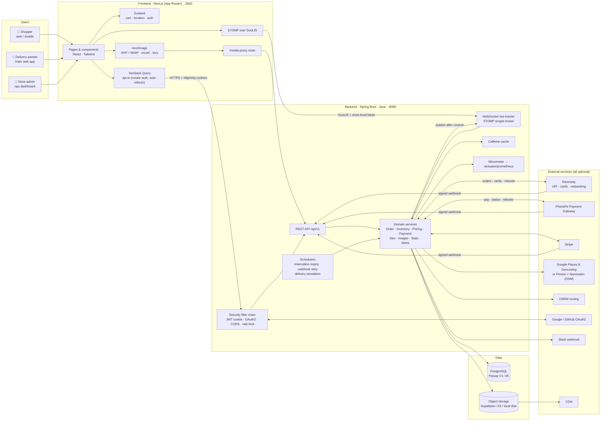
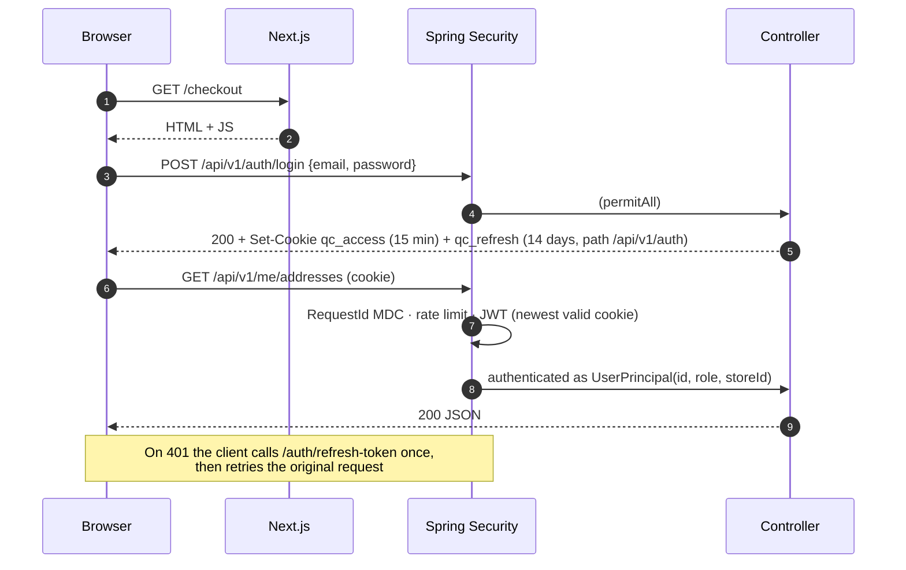
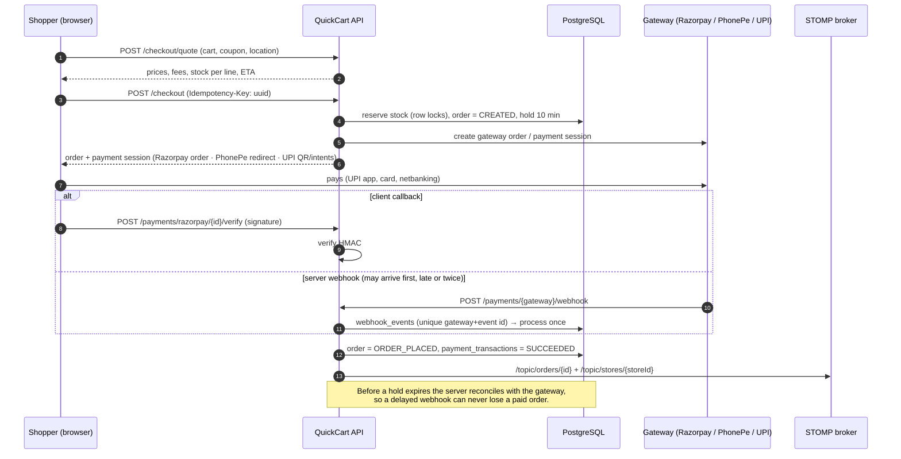
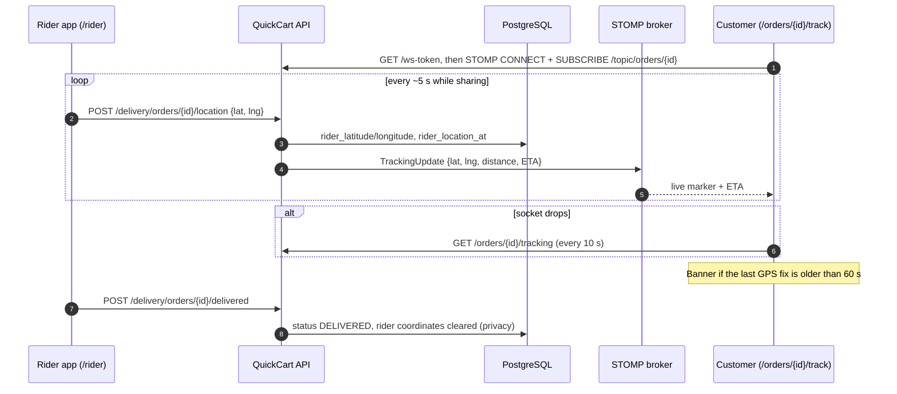
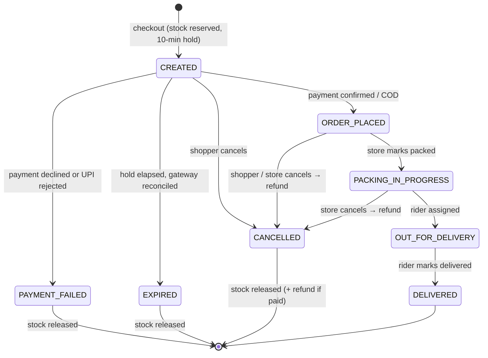
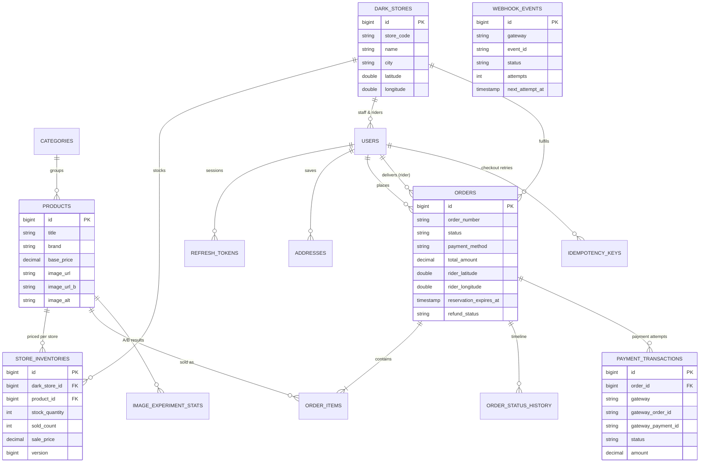
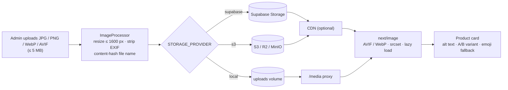

# QuickCart — Architecture

This document explains how the pieces of QuickCart fit together: the runtime topology, the data model, and the three flows that matter most (checkout & payment, live tracking, and order lifecycle). All diagrams are [Mermaid](https://mermaid.js.org/) and render directly on GitHub.

- [1. System overview](#1-system-overview)
- [2. Request path & security](#2-request-path--security)
- [3. Checkout & payment flow](#3-checkout--payment-flow)
- [4. Live order tracking](#4-live-order-tracking)
- [5. Order lifecycle](#5-order-lifecycle)
- [6. Data model](#6-data-model)
- [7. Product images pipeline](#7-product-images-pipeline)
- [8. Reliability patterns](#8-reliability-patterns)
- [9. Observability](#9-observability)

---

## 1. System overview

| Layer | Responsibility |
|---|---|
| **Next.js frontend** | Server-renders pages, owns client state (cart, chosen dark store), talks to the API with HttpOnly cookies, subscribes to live updates over STOMP. |
| **Spring Boot API** | Stateless REST + WebSocket. Every order is scoped to a dark store; prices and stock are per-store. |
| **PostgreSQL** | Source of truth, versioned with Flyway. Stock is reserved with row locks (`SELECT … FOR UPDATE`, taken in product-id order so concurrent checkouts can't deadlock). |
| **Object storage** | Product photos (Supabase Storage, any S3-compatible bucket, or local disk), optionally fronted by a CDN. |
| **External services** | Every integration is optional and switched on by environment variables; the app boots with none of them. |

---

## 2. Request path & security

- **Auth** — short-lived access JWT + rotating, hashed refresh token, both in HttpOnly `SameSite` cookies; optional Google/GitHub OAuth2 login.
- **Roles** — `ROLE_CUSTOMER`, `ROLE_DELIVERY_PARTNER`, `ROLE_STORE_ADMIN` (scoped to one store, or all stores when `storeId` is null).
- **WebSockets** — the browser fetches a 2-minute token from `/api/v1/auth/ws-token` before each STOMP `CONNECT`; subscriptions to `/topic/orders/{id}` and `/topic/stores/{id}` are authorised per frame.
- **Webhooks** — signature-verified (HMAC-SHA256 for Razorpay/Stripe, SHA-256 credentials for PhonePe) and excluded from rate limiting.

---

## 3. Checkout & payment flow

| Method | How it works |
|---|---|
| **Razorpay** | Server creates a Razorpay order → Checkout.js (UPI-first) → signature verify + `payment.captured` webhook. Refunds via API. |
| **PhonePe Payment Gateway** | OAuth `O-Bearer` token → `/checkout/v2/pay` redirect → status API + webhook. Refunds via API. |
| **Direct UPI** | `upi://pay` intent links for Google Pay / PhonePe / Paytm plus a QR code; the shopper submits the UTR and the store verifies it in the control tower (auto-confirm in sandbox). |
| **Stripe** | PaymentIntents for international cards. |
| **Cash on delivery** | Order is placed immediately. |

---

## 4. Live order tracking

Customers only ever see the rider's first name and a "Call support" button — never the rider's phone number.

---

## 5. Order lifecycle

---

## 6. Data model

Migrations live in [`backend/src/main/resources/db/migration`](../backend/src/main/resources/db/migration):

| Version | Contents |
|---|---|
| V1 | Core schema: stores, users, categories, products, per-store inventory, coupons, orders, items, status history |
| V2 | Catalogue seed: 7 dark stores, 26 categories, 192 products, 1,344 inventory rows |
| V3 | Login stats, sold counts, image fields |
| V4 | Three Andhra Pradesh dark stores (Vijayawada ×2, Guntur) |
| V5 | Payments, webhook inbox, idempotency keys, structured addresses, image A/B stats, rider freshness |
| V6 | Real product photography for fresh produce + 24 more fruits & vegetables |

---

## 7. Product images pipeline

Content-hashed names make every URL immutable, so browsers and CDNs can cache for a year and a new photo is picked up instantly. Each product can carry a **B photo**; the storefront splits traffic 50/50, records impressions and add-to-carts, and the admin can promote the winner.

---

## 8. Reliability patterns

| Concern | Pattern |
|---|---|
| Double-clicks / retries on checkout | `Idempotency-Key` header → same order returned for the same key |
| Overselling | Per-store stock reserved at checkout under row locks (all-or-nothing); released on failure/expiry/cancel |
| Duplicate or out-of-order webhooks | Inbox table, unique `(gateway, event_id)`, processed once in its own transaction |
| Failed webhook processing | Exponential back-off retry (1 → 60 min), `DEAD` after max attempts with a Slack alert |
| Lost webhooks | Gateway status reconciliation before a reservation expires |
| Flaky third-party APIs | Shared HTTP client: timeouts, 3 attempts with back-off for idempotent calls, per-call metrics |
| WebSocket outages | Polling fallback every 10 s, stale-location warning, socket never torn down by a denied subscription |

---

## 9. Observability

- Every response carries an `X-Request-Id`, and every log line includes it.
- `/actuator/prometheus` exposes HTTP latency histograms, `quickcart.external.calls` timers and business counters.
- `docker compose --profile monitoring up` starts Prometheus (:9090) and Grafana (:3001) with a provisioned **QuickCart Ops** dashboard.
- Slack alerts for new orders, low stock, payment failures and dead webhooks (when `SLACK_WEBHOOK_URL` is set).
